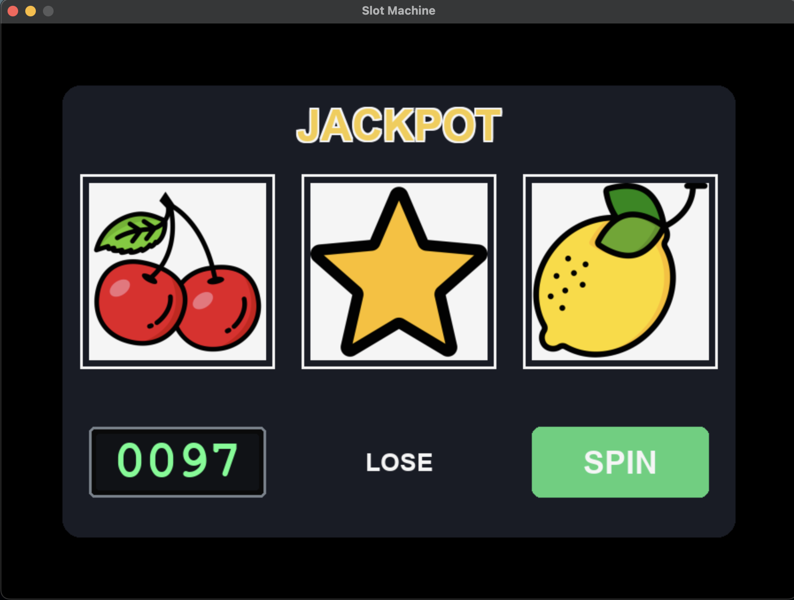

# Slot Machine

I. Project Overview

This project is developed for educational and simulation purposes only, recreating a classic three-reel slot machine.

II. Development Environment
- Programming Language: Python
- Editor / IDE: Visual Studio Code

III. Dependencies
- Pygame: Used for the visualization of the drone simulation.

IV. Image Source

Icon assets sourced from Flaticon free resources.
- CHERRY.png: https://www.flaticon.com/free-icon/berry_15685526?term=cherry&page=1&position=1&origin=search&related_id=15685526
- LEMON.png: https://www.flaticon.com/free-icon/lemon_3137034?term=lemon&page=1&position=15&origin=search&related_id=3137034
- BELL.png: https://www.flaticon.com/free-icon/bell_1827272?term=bell&page=1&position=47&origin=search&related_id=1827272
- STAR.png: https://www.flaticon.com/free-icon/star_1828614?term=star&page=1&position=46&origin=search&related_id=1828614
- BAR.png: https://www.flaticon.com/free-icon/bar_8273908?term=slot+machine+bar&page=1&position=4&origin=search&related_id=8273908
- 7.png: https://www.flaticon.com/free-icon/slot-machine_9455719?term=7&page=1&position=22&origin=search&related_id=9455719

V. Results
 
  

  	
  

 
